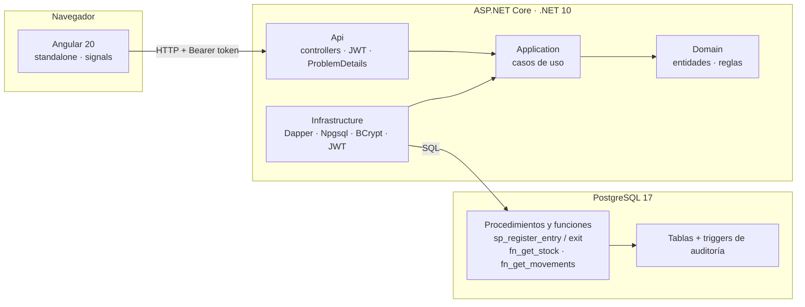

# Prueba CCL · Sistema de Gestión de Inventario

[](https://github.com/paopadp123/Prueba_CCL/actions/workflows/ci.yml)

Aplicación web para administrar un catálogo de productos, registrar **entradas y salidas** de inventario y consultar el **stock actual**, con autenticación por roles y trazabilidad completa de cada movimiento.

- **Backend:** C# / .NET 10 (ASP.NET Core Web API), Clean Architecture, Dapper.
- **Base de datos:** PostgreSQL 17, con la lógica de stock en **procedimientos almacenados** y auditoría por triggers.
- **Frontend:** Angular 20 (standalone, signals, zoneless), responsivo, con modo claro y oscuro.
- **Seguridad:** JWT con roles `Admin` y `Operator`, contraseñas con BCrypt y límite de intentos de login.
- **Calidad:** 220+ pruebas automáticas y CI en GitHub Actions (base de datos, backend, frontend y docker-compose de punta a punta).

---

## Contenido

1. [Funcionalidades](#funcionalidades)
2. [Ejecución rápida con Docker](#ejecución-rápida-con-docker)
3. [Ejecución local paso a paso](#ejecución-local-paso-a-paso)
4. [Pruebas](#pruebas)
5. [Arquitectura](#arquitectura)
6. [API](#api)
7. [Manejo de errores](#manejo-de-errores)
8. [Seguridad](#seguridad)
9. [Decisiones de arquitectura (ADR)](#decisiones-de-arquitectura-adr)
10. [Flujo de trabajo](#flujo-de-trabajo)

---

## Funcionalidades

| Módulo | Qué permite | Quién |
|---|---|---|
| **Inicio** | Tablero con stock bajo, valor del inventario, movimientos de los últimos 7 días, últimos movimientos y alertas | Todos |
| **Productos** | Listado con búsqueda y paginación, ficha con historial, alta, edición y activación/desactivación (baja lógica) | Consulta: todos · Cambios: Admin |
| **Movimientos** | Registro de entradas y salidas, historial general y por producto | Todos |
| **Stock** | Unidades y valor por producto, con alertas de "sin stock" y "stock bajo" | Todos |

Reglas de negocio principales:

- **El stock nunca queda negativo**, ni siquiera con salidas simultáneas: el procedimiento almacenado bloquea la fila del producto (`SELECT … FOR UPDATE`). Hay una prueba que lanza 10 salidas concurrentes sobre 5 unidades y verifica que se aceptan exactamente 5.
- **El stock solo cambia con movimientos.** Un producto nace con stock 0, y los movimientos no se editan ni se borran: un error se corrige con el movimiento contrario.
- **Cada movimiento guarda quién lo hizo**, tomado del token y no de la petición, y queda en la auditoría.
- **El SKU es único e inmutable**, y los productos no se borran físicamente: se desactivan y conservan su historial.

---

## Ejecución rápida con Docker

Requisito: [Docker Desktop](https://www.docker.com/products/docker-desktop/) (o Docker Engine con Compose v2).

```bash
git clone https://github.com/paopadp123/Prueba_CCL.git
cd Prueba_CCL
docker compose up --build
```

| Servicio | URL |
|---|---|
| Aplicación web | http://localhost:4200 |
| API · Swagger | http://localhost:5197/swagger |
| Health check | http://localhost:4200/health |
| PostgreSQL | `localhost:5433` (usuario `postgres`, contraseña `postgres`) |

**Usuarios de prueba**

| Usuario | Contraseña | Rol |
|---|---|---|
| `admin` | `Admin123*` | Admin: todo |
| `operador` | `Operador123*` | Operator: consulta y registra movimientos |

Cómo funciona:
- La primera vez, PostgreSQL ejecuta los scripts de `database/` en orden: esquema, auditoría, procedimientos y datos de ejemplo.
- nginx sirve el front y reenvía `/api` a la API, así el navegador ve un solo origen.
- Para empezar de cero: `docker compose down --volumes`.

> Las claves de `docker-compose.yml` son **solo para la demo local**. Para cambiarlas, copia `.env.example` como `.env`.

---

## Ejecución local paso a paso

### Requisitos

- [.NET SDK 10](https://dotnet.microsoft.com/download) (la versión exacta está en `global.json`)
- [Node.js 22+](https://nodejs.org/) y npm
- [PostgreSQL 17](https://www.postgresql.org/download/) (necesita la extensión `pgcrypto`, incluida en la instalación estándar)

### 1. Base de datos

```bash
createdb -U postgres inventory
for script in database/0*.sql; do psql -U postgres -d inventory -v ON_ERROR_STOP=1 -f "$script"; done
```

En Windows (PowerShell):

```powershell
& "C:\Program Files\PostgreSQL\17\bin\createdb.exe" -U postgres inventory
Get-ChildItem database\0*.sql | ForEach-Object { & "C:\Program Files\PostgreSQL\17\bin\psql.exe" -U postgres -d inventory -v ON_ERROR_STOP=1 -f $_.FullName }
```

Los scripts son idempotentes: se pueden ejecutar más de una vez. Detalle de cada uno en [`database/README.md`](database/README.md).

### 2. API

La cadena de conexión y la clave de firma del JWT **no están en el repositorio**; se configuran con [user-secrets](https://learn.microsoft.com/aspnet/core/security/app-secrets):

```bash
cd src/Inventory.Api
dotnet user-secrets set "ConnectionStrings:Inventory" "Host=localhost;Port=5432;Database=inventory;Username=postgres;Password=<tu-clave>"
dotnet user-secrets set "Jwt:SigningKey" "<clave-de-al-menos-32-caracteres>"
dotnet run
```

> Para generar una clave segura: `openssl rand -base64 48`, o en PowerShell `[Convert]::ToBase64String((1..48 | % { Get-Random -Max 256 }))`.

- API: http://localhost:5197
- Swagger: http://localhost:5197/swagger. Para probar endpoints protegidos: `POST /api/auth/login`, copia el `accessToken` y pégalo en **Authorize**.
- Logs: en la consola y en `src/Inventory.Api/logs/`.

Si falta la cadena de conexión o la clave JWT, la API no arranca y lo dice explícitamente (las opciones se validan al iniciar).

### 3. Frontend

```bash
cd frontend
npm install
npm start
```

Abre http://localhost:4200. La URL de la API está en `src/environments/environment.development.ts`, y el CORS de la API ya permite ese origen.

---

## Pruebas

| Conjunto | Comando | Qué cubre |
|---|---|---|
| Base de datos | `for t in database/tests/*.test.sql; do psql -U postgres -d inventory -v ON_ERROR_STOP=1 -f "$t"; done` | Esquema, restricciones, auditoría y procedimientos |
| Backend: unitarias (113) | `dotnet test tests/Inventory.UnitTests` | Dominio, casos de uso, mapeo de errores, seguridad y reglas de arquitectura |
| Backend: integración (51) | `dotnet test tests/Inventory.IntegrationTests` | Repositorios y endpoints contra PostgreSQL real, incluida la concurrencia de salidas |
| Frontend (59) | `cd frontend && npm test -- --watch=false --browsers=ChromeHeadless` | Servicios, interceptores, guards, formularios, menús, tema y cálculos del tablero |

Las pruebas de integración crean su propia base `inventory_test` desde los scripts; necesitan la variable de entorno con la conexión:

```bash
export INVENTORY_TEST_CONNECTION="Host=localhost;Port=5432;Database=inventory_test;Username=postgres;Password=<tu-clave>"
```

El **CI** ([`.github/workflows/ci.yml`](.github/workflows/ci.yml)) corre todo en cada push y pull request:

| Job | Qué hace |
|---|---|
| Database | Aplica los scripts dos veces (comprueba que son idempotentes) y corre sus pruebas |
| Backend | Compila con advertencias tratadas como errores y corre las pruebas unitarias y de integración contra un PostgreSQL 17 |
| Frontend | Corre las pruebas en Chrome headless y compila para producción |
| Docker Compose | Levanta el sistema completo y prueba login y consulta de stock a través de nginx |

---

## Arquitectura



**Capas (Clean Architecture):** las dependencias apuntan hacia el dominio. Una prueba de arquitectura lo verifica: Domain no depende de nadie y Application no conoce a Infrastructure.

| Proyecto | Responsabilidad |
|---|---|
| `Inventory.Domain` | Entidades (`Product`, `Movement`), objetos de valor (`Sku`, `Quantity`), reglas y excepciones de negocio |
| `Inventory.Application` | Casos de uso (`ProductService`, `MovementService`, `StockService`, `LoginService`) e interfaces que implementa la infraestructura |
| `Inventory.Infrastructure` | Repositorios con Dapper, mapeo de errores de PostgreSQL, BCrypt, emisión de JWT, health check |
| `Inventory.Api` | Controllers, contratos, autenticación, ProblemDetails, correlation id, logs (Serilog), Swagger |

**Frontend**, organizado por funcionalidad:

```
frontend/src/app/
├── core/        sesión (signals), interceptores JWT y de errores, guards, layout, tema
├── shared/      modelos de paginación, estado de carga, íconos SVG, paginador
└── features/    login · home (tablero) · products · movements · stock  (todas con lazy loading)
```

**Estructura del repositorio**

```
├── database/        scripts SQL (01..04) y sus pruebas
├── src/             backend .NET (Domain, Application, Infrastructure, Api)
├── tests/           pruebas unitarias y de integración del backend
├── frontend/        aplicación Angular
├── docs/adr/        decisiones de arquitectura
├── docker-compose.yml
└── .github/workflows/ci.yml
```

---

## API

Todos los endpoints, salvo el login y el health check, requieren `Authorization: Bearer <token>`. La documentación interactiva está en `/swagger`.

| Método | Ruta | Rol | Descripción |
|---|---|---|---|
| `POST` | `/api/auth/login` | Público | Devuelve el token (60 min) y los datos del usuario. Máximo 5 intentos por minuto por IP |
| `GET` | `/api/auth/me` | Todos | Usuario autenticado |
| `GET` | `/api/products?search=&includeInactive=&page=&pageSize=` | Todos | Listado paginado |
| `GET` | `/api/products/{id}` | Todos | Detalle |
| `POST` | `/api/products` | Admin | Crea un producto (stock inicial 0) |
| `PUT` | `/api/products/{id}` | Admin | Edita nombre, descripción y precio (el SKU no cambia) |
| `PATCH` | `/api/products/{id}/status` | Admin | Activa o desactiva (baja lógica) |
| `POST` | `/api/movements/entries` | Todos | Registra una entrada |
| `POST` | `/api/movements/exits` | Todos | Registra una salida; `409` si no alcanza el stock |
| `GET` | `/api/movements?page=&pageSize=` | Todos | Historial general |
| `GET` | `/api/products/{id}/movements` | Todos | Historial de un producto |
| `GET` | `/api/stock?search=&includeInactive=&page=&pageSize=` | Todos | Stock y valor por producto |
| `GET` | `/api/products/{id}/stock` | Todos | Stock de un producto |
| `GET` | `/health` | Público | Estado de la API y de la base de datos |

Ejemplo:

```bash
curl -X POST http://localhost:5197/api/movements/exits \
  -H "Authorization: Bearer $TOKEN" -H "Content-Type: application/json" \
  -d '{"productId": 1, "quantity": 3, "reason": "Venta"}'
```

---

## Manejo de errores

Todos los errores siguen **ProblemDetails (RFC 9457)**, con un `code` estable que el front usa para decidir qué mostrar y un `correlationId` para encontrar la petición en los logs:

```json
{
  "status": 409,
  "title": "Stock insuficiente",
  "detail": "Stock insuficiente: disponible 3, solicitado 5.",
  "code": "insufficient_stock",
  "available": 3,
  "requested": 5,
  "correlationId": "4f1c…"
}
```

| HTTP | `code` | Origen |
|---|---|---|
| 400 | `validation_error`, `invalid_sku`, `invalid_quantity` | Validación de la petición o del dominio |
| 401 | `invalid_credentials` | Login fallido (mismo mensaje y tiempo de respuesta exista o no el usuario) |
| 403 | — | El rol no tiene permiso |
| 404 | `product_not_found` | `IN001` en PostgreSQL |
| 409 | `insufficient_stock` · `inactive_product` · `duplicate_sku` | `IN002` · `IN003` · índice único |
| 429 | `too_many_requests` | Límite de intentos de login |
| 500 | `unexpected_error` | Mensaje genérico; el detalle solo queda en los logs |

Los errores de negocio nacen en los procedimientos almacenados con SQLSTATE propios (`IN001`…`IN005`). La infraestructura los traduce a excepciones de dominio y la API a HTTP. En el front, el interceptor muestra como aviso global los errores de conexión, permisos y servidor; los de negocio se muestran junto al campo correspondiente.

---

## Seguridad

- **Secretos fuera del repositorio:** cadena de conexión y clave JWT en user-secrets o variables de entorno; la API valida al iniciar que existan.
- **Contraseñas** con BCrypt. El login responde igual, y en el mismo tiempo, si el usuario no existe, está inactivo o la clave es incorrecta, para no revelar qué usuarios existen.
- **JWT** HS256 de 60 minutos, validado en emisor, audiencia, firma y vencimiento. Por defecto toda ruta exige autenticación (*fallback policy*) y las de escritura del catálogo exigen el rol `Admin`.
- **Límite de intentos de login:** 5 por minuto por IP, con `429` y `Retry-After`.
- **SQL parametrizado** en todos los accesos (Dapper), sin concatenar texto del usuario.
- **Front:** el token va en `sessionStorage` (se borra al cerrar la pestaña) y solo se envía a la API propia. Al recibir un `401` se cierra la sesión, y el `returnUrl` del login solo acepta rutas internas para evitar redirecciones a sitios externos.
- **Auditoría** de todo cambio en usuarios, productos y movimientos, sin guardar nunca el hash de la contraseña.

---

## Decisiones de arquitectura (ADR)

Las decisiones importantes están documentadas en [`docs/adr/`](docs/adr/README.md), con su contexto, las alternativas consideradas y sus consecuencias.

| # | Decisión |
|---|---|
| [0001](docs/adr/0001-clean-architecture.md) | Clean Architecture ligera, sin MediatR ni AutoMapper |
| [0002](docs/adr/0002-stock-en-procedimientos-almacenados.md) | Reglas de stock en procedimientos almacenados con bloqueo de fila |
| [0003](docs/adr/0003-dapper-en-lugar-de-ef-core.md) | Dapper en lugar de Entity Framework Core |
| [0004](docs/adr/0004-auditoria-con-triggers.md) | Auditoría con triggers en la base de datos |
| [0005](docs/adr/0005-errores-con-problem-details.md) | Errores con ProblemDetails y códigos estables |
| [0006](docs/adr/0006-autenticacion-jwt.md) | Autenticación JWT sin estado y token en sessionStorage |
| [0007](docs/adr/0007-movimientos-inmutables-y-baja-logica.md) | Movimientos inmutables y baja lógica de productos |
| [0008](docs/adr/0008-frontend-angular-sin-libreria-ui.md) | Frontend Angular moderno sin librería de componentes |

---

## Flujo de trabajo

- **Historias de usuario** HU-00 a HU-13 como [issues de GitHub](https://github.com/paopadp123/Prueba_CCL/issues?q=is%3Aissue), cada una con sus criterios de aceptación.
- **Ramas:** `feature/hu-xx` → pull request a `dev` (con CI) → `main` en cada hito.
- **Commits** con [Conventional Commits](https://www.conventionalcommits.org/) en español (`feat`, `fix`, `test`, `refactor`, `docs`, `ci`), cada uno con su referencia al issue.
